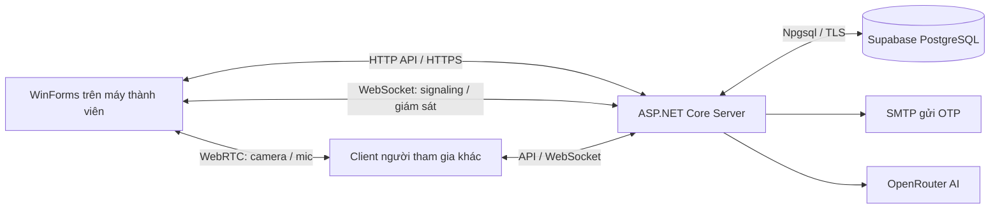
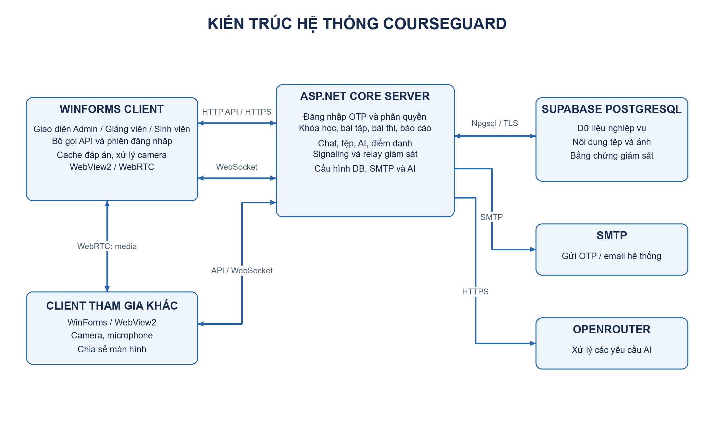

# CourseGuard

Ứng dụng C#/.NET 10 Windows Forms quản lý khóa học, bài tập, thi và lớp học trực tuyến. Bản hiện tại dùng **WinForms → ASP.NET Core Server → PostgreSQL**.

Client giữ giao diện hiện có và gọi API bằng phiên đăng nhập có OTP. Database, SMTP và khóa AI đặt ở server. Signaling lớp học và camera giám sát đi qua server có xác thực; âm thanh/video WebRTC trao đổi theo cơ chế WebRTC.

## Sơ đồ hệ thống





Trong lúc phát triển, mỗi thành viên chạy server và app trên máy mình. Các server local có thể dùng chung database Supabase dev của nhóm; không cần thuê server chung để sửa code.

## Lấy code và tạo nhánh làm việc

Bản client–server hiện ở nhánh `feat/server-api`, PR #7 chưa merge vào `main`.

```powershell
git clone --branch feat/server-api https://github.com/Dotuantai24521545/CourseGuard-project-NT106.git
cd CourseGuard-project-NT106
git switch -c feat/ten-phan-viec
```

Nếu đã có repo trên máy: lưu các thay đổi đang làm vào nhánh riêng trước, rồi `git fetch origin` và chuyển sang `feat/server-api`. Không ghi đè công việc chưa commit. Sau khi PR #7 được merge, các nhánh mới có thể bắt đầu từ `main` đã cập nhật.

## Mỗi thành viên chạy server và app local

Cần Windows, .NET SDK 10, WebView2 Runtime và database dev của nhóm đã khởi tạo.

1. Nhận file cấu hình server từ trưởng nhóm qua kênh riêng và đặt tại **`CourseGuard/CourseGuard.Server/.env`**. Hoặc sao chép file mẫu cạnh nó rồi tự điền database/SMTP; thêm `OPENROUTER_API_KEY` nếu dùng AI. Không đặt file server vào thư mục client.
2. Tại gốc repo, chạy:

```powershell
powershell.exe -ExecutionPolicy Bypass -File scripts/Start-CourseGuard.ps1
```

Script build lần đầu, chạy server nền tại `http://127.0.0.1:5080`, rồi mở WinForms. Gói chạy nằm ở `.local/server` và `.local/client`. Cấu hình client chỉ có `COURSEGUARD_API_URL`. Chạy lại script để mở thêm client.

```env
COURSEGUARD_API_URL=http://127.0.0.1:5080
```

`127.0.0.1` là máy đang chạy app: mỗi bạn có server local riêng, không kết nối tới máy trưởng nhóm. Script tự tạo cấu hình client ở trên. Không cần sửa server URL mỗi lần chạy.

## Sau khi sửa code hoặc lấy code mới

Đóng các cửa sổ app của bản đang sửa, dừng server local, build lại rồi chạy:

```powershell
powershell -ExecutionPolicy Bypass -File scripts/Stop-CourseGuardServer.ps1
powershell.exe -ExecutionPolicy Bypass -File scripts/Start-CourseGuard.ps1 -BuildOnly
powershell.exe -ExecutionPolicy Bypass -File scripts/Start-CourseGuard.ps1
```

Script dừng chỉ tác động tới server của repo này. Đóng cửa sổ WinForms không tự dừng server nền. Nếu chỉ mở thêm app và không đổi code, dùng lệnh Start bình thường, không cần build lại.

## Commit và gửi PR

```powershell
git status
git add <cac-file-ma-nguon-da-sua>
git commit -m "Mo ta thay doi"
git push -u origin feat/ten-phan-viec
```

Tạo Pull Request từ nhánh của mình. Khi PR #7 còn mở, chọn base `feat/server-api` cho phần việc dựa trên kiến trúc mới; sau khi kiến trúc đã vào `main`, chọn base `main`. `.env`, `.local`, file build và log không được đưa vào commit.

Database dev có thể dùng chung, nên việc thêm/sửa/xóa dữ liệu ảnh hưởng các bạn khác. Dùng dữ liệu thử có tên riêng, không chạy script reset schema. OTP của tài khoản nào gửi về email được lưu cho tài khoản đó trong database.

## Chạy client trên máy khác

Triển khai server Windows với HTTPS, rồi chạy:

```powershell
powershell.exe -ExecutionPolicy Bypass -File scripts/Start-CourseGuard.ps1 -ClientOnly -ApiUrl https://YOUR_SERVER
```

Không đưa mật khẩu database, SMTP hoặc khóa AI vào client. OTP gửi tới email trong bản ghi tài khoản; SMTP trong cấu hình server là bên gửi thư.

- [Cấu hình, kiến trúc và kiểm thử](docs/README.md)
- [Sơ đồ kiến trúc](docs/architecture.md)
- [Kết quả chuyển đổi](docs/SERVER_MIGRATION.md)
- [Phân công tính năng](docs/TEAM_HANDOFF.md)

Các nhánh cải tiến tính năng của thành viên vẫn cần review và tích hợp riêng. Chuyển sang API không đồng nghĩa mọi tính năng đã được nghiệm thu trên nhiều máy/khác mạng.
