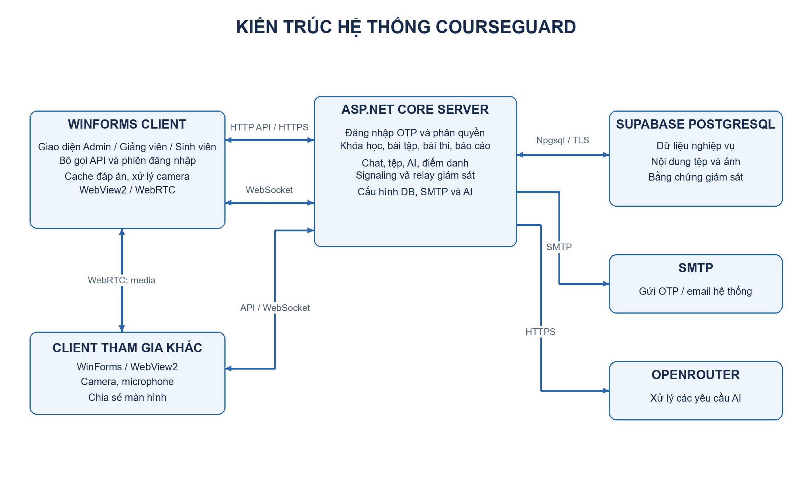
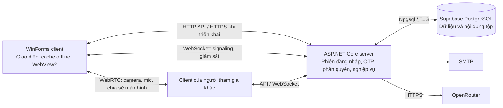

# Kiến trúc CourseGuard

Client không cần mật khẩu database, SMTP hay khóa AI. Các thao tác dữ liệu từ WinForms đi qua API; server lấy danh tính từ phiên và kiểm tra quyền trước khi truy cập database.

Trong giai đoạn chuyển đổi, server liên kết lại các lớp Controllers/Data/Models của dự án; `COURSEGUARD_SERVER` phân biệt bản biên dịch nghiệp vụ trên server với adapter trên client. `CourseGuardDbContext` là lớp SQL dùng Npgsql, không phải Entity Framework. Chưa tách hết thành các thư viện độc lập; điều này không làm các truy vấn chạy trên máy client khi dùng API mode.

Chat cập nhật qua API định kỳ 2 giây; trạng thái lớp đọc định kỳ 3 giây. Server chuyển signaling WebRTC và frame giám sát bằng WebSocket. Media WebRTC dùng kết nối giữa người tham gia, có thể cần TURN khi khác mạng; không truyền media qua database.

Ảnh/tệp được lưu qua server trong PostgreSQL. Kết nối Storage/Realtime Supabase của phiên bản cũ không phải đường dữ liệu mặc định của bản API. `CourseGuardRelayApi` cũ được giữ để tham khảo và tương thích, không cần chạy cùng server mới.

Xem [kết quả kiểm thử](SERVER_MIGRATION.md) để phân biệt luồng đã chạy thật với kiểm tra mô phỏng và các giới hạn còn lại.
