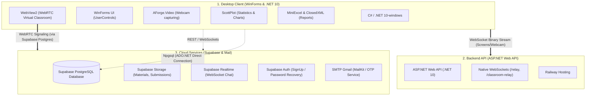
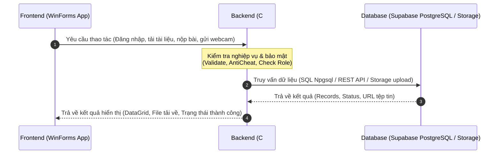
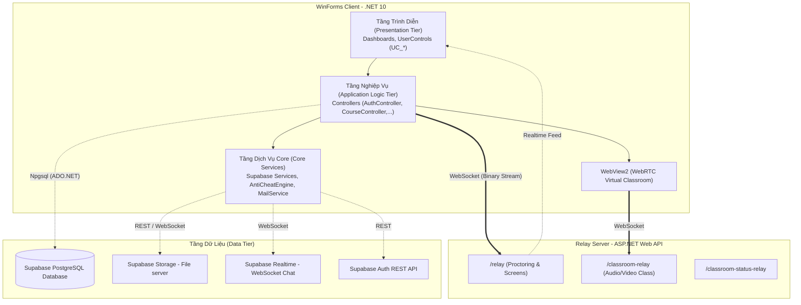

# TÀI LIỆU GIỚI THIỆU & PHÂN TÍCH KIẾN TRÚC HỆ THỐNG COURSEGUARD

Hệ thống **CourseGuard** là một nền tảng quản lý khóa học và thi trực tuyến toàn diện, tích hợp các công nghệ hiện đại nhằm tối ưu hiệu năng và đảm bảo tính minh bạch, bảo mật trong môi trường giáo dục số.

---

## I. TỔNG QUAN DỰ ÁN & VẤN ĐỀ ĐẶT RA (OVERVIEW & PROBLEM STATEMENT)

### 1. Tổng quan về dự án CourseGuard
**CourseGuard** được thiết kế như một giải pháp tích hợp tất cả trong một (All-in-One System) phục vụ cả hai nhu cầu cốt lõi của giáo dục hiện đại: **Quản lý học tập (LMS - Learning Management System)** và **Tổ chức thi trực tuyến bảo mật (Secure Online Examination)**. Khác với các hệ thống web thông thường, CourseGuard tận dụng sức mạnh của ứng dụng Desktop Client viết bằng C# .NET để có khả năng can thiệp sâu vào hệ thống phần cứng và hệ điều hành của người dùng, mang lại một môi trường thi cử an toàn và bảo mật cao.

### 2. Vấn đề đặt ra cho sự tồn tại của dự án (Lý do ra đời)
Sự chuyển dịch mạnh mẽ sang hình thức đào tạo trực tuyến mở ra nhiều cơ hội học tập linh hoạt nhưng cũng đặt ra những thách thức bảo mật nghiêm trọng mà các giải pháp hiện tại chưa giải quyết triệt để:

*   **Bùng nổ gian lận thi cử trực tuyến:** Khi thực hiện bài thi qua trình duyệt web thông thường, học viên rất dễ chuyển đổi tab/cửa sổ để tra cứu thông tin, sử dụng phím tắt (`Alt+Tab`, `Windows`) hoặc chạy các ứng dụng trò chuyện (Discord, Zalo) để gian lận.
*   **Hạn chế của các công cụ giám sát thông thường:** Giám sát qua camera họp trực tuyến thông thường (Zoom, Google Meet) chỉ thấy được góc mặt của thí sinh mà không thể kiểm soát được màn hình hiển thị hoặc các thiết bị ngoại vi được cắm thêm (như màn hình phụ chia sẻ bài ra ngoài).
*   **Nguy cơ mất mát dữ liệu do kết nối không ổn định:** Trục trặc đường truyền Internet đột ngột trong lúc làm bài thi online thường dẫn đến việc mất bài làm của sinh viên, gây gián đoạn quy trình và thiếu công bằng.
*   **Trải nghiệm người dùng bị phân mảnh:** Các cơ sở giáo dục thường phải kết hợp nhiều công cụ rời rạc (học trên Moodle/Canvas, họp trên Zoom, giám sát thi bằng phần mềm bên thứ ba đắt đỏ). Sự phân mảnh này vừa làm tăng chi phí vận hành, vừa gây khó khăn cho cả giảng viên lẫn học sinh trong việc đồng bộ dữ liệu điểm số và học liệu.

=> **CourseGuard** ra đời nhằm giải quyết triệt để các vấn đề trên, tạo ra cầu nối vững chắc giữa việc học tập trực tuyến linh hoạt và quy trình thi cử nghiêm túc, an toàn và bảo mật tối đa.

### 3. Phạm vi dự án (Project Scope)
Dự án được định vị tập trung vào các phạm vi cụ thể sau:
*   **Hệ thống giáo dục nội bộ:** Phần mềm hướng tới mục tiêu phục vụ hoạt động đào tạo, quản lý và tổ chức thi nội bộ cho một trường học, trung tâm giáo dục hoặc cơ quan/doanh nghiệp nhất định. Toàn bộ thông tin học viên, giảng viên, thiết bị được kiểm soát và lưu trữ tập trung.
*   **Quy trình đào tạo trực tuyến khép kín:** Bao trùm từ khâu quản lý danh mục môn học, xếp thời khóa biểu, điểm danh học viên, phân phối học liệu (slides/tài liệu bài giảng), giao nhận bài tập tự luận cho đến khâu tổ chức các lớp học trực tuyến (Virtual Classrooms) và đánh giá năng lực qua thi cử có giám sát bảo mật chặt chẽ.

---

## II. CÔNG NGHỆ SỬ DỤNG (TECHNOLOGY STACK)

*(Hình ảnh Tech Stack của 3 phần hệ thống được lưu trữ riêng biệt tại: [images/tech_stack.png](file:///c:/Documentss/LtrinhMangCanBan/NT106_QuanLyKhoaHoc_ThiOnline/images/tech_stack.png))*

#### Sơ đồ Mermaid biểu diễn Tech Stack của 3 phần:

Hệ thống được phát triển trên mô hình kết hợp (Hybrid) giữa **Windows Forms Desktop Client** hiệu năng cao và **Cloud Services/WebSockets** nhằm đáp ứng khả năng giám sát thời gian thực ổn định.

### 1. Phân hệ Desktop Client (CourseGuard Client)
*   **Ngôn ngữ & Framework:** C# chạy trên nền tảng `.NET 10.0-windows` (Windows Forms).
*   **Kết nối Cơ sở dữ liệu:** `Npgsql` (ADO.NET Provider cho PostgreSQL), kết nối trực tiếp đến PostgreSQL Server giúp tối ưu hóa tốc độ truy vấn không qua ORM trung gian cồng kềnh.
*   **Đồ họa & Trực quan hóa:** `ScottPlot.WinForms` để vẽ biểu đồ thống kê học tập và tình hình thi cử động.
*   **Xử lý Excel:** `MiniExcel` và `ClosedXML` hỗ trợ đọc/ghi và xuất báo cáo danh sách điểm, sinh viên tốc độ cao.
*   **Camera & Đa phương tiện:** `AForge.Video` & `AForge.Video.DirectShow` để kiểm soát camera và thu hình webcam trực tiếp từ thiết bị học viên.
*   **Trình nhúng Web:** `Microsoft.Web.WebView2` để nhúng giao diện WebRTC hỗ trợ lớp học ảo tương tác.
*   **Môi trường:** `DotNetEnv` quản lý các cấu hình nhạy cảm qua file `.env`.

### 2. Phân hệ Backend API (CourseGuardRelayApi)
*   **Framework:** ASP.NET Web API (`net10.0`).
*   **Phương thức truyền tải:** **WebSockets (Native)** truyền luồng dữ liệu nhị phân (Binary) dung lượng lớn ở tần suất cao, phục vụ truyền phát (Relay) ảnh màn hình, webcam và âm thanh phòng học.
*   **Nền tảng triển khai:** Deploy trực tuyến trên môi trường Cloud (Railway).

### 3. Phân hệ Cloud Services (Supabase Platform)
*   **Database:** **Supabase PostgreSQL** hosted trên nền tảng AWS (Tokyo), hỗ trợ pooling kết nối.
*   **Realtime Signaling:** Sử dụng **Supabase Realtime (WebSocket-based)** để đồng bộ hóa tin nhắn chat và thông báo vi phạm thi tức thời.
*   **Authentication:** **Supabase Auth REST API** dùng để gửi email khôi phục mật khẩu (`recover`) và đăng ký tài khoản mới (`signup`).
*   **Storage:** **Supabase Storage Buckets** lưu trữ tài liệu học tập, ảnh đại diện và các bài nộp tự luận của sinh viên.
*   **Email Service:** Tích hợp **SMTP Gmail** (`MailKit` / `Google.Apis.Gmail.v1`) để gửi mã OTP, thông báo tự động.

---

## III. KIẾN TRÚC 3 TẦNG CỦA HỆ THỐNG (3-TIER ARCHITECTURE)

### 1. Luồng tương tác đơn giản (FE - BE - DB)
Dưới đây là sơ đồ mô tả luồng tương tác cơ bản giữa Giao diện người dùng (Frontend), Bộ phận xử lý nghiệp vụ/API trung gian (Backend) và Cơ sở dữ liệu (Database):

### 2. Kiến trúc chi tiết hệ thống
Hệ thống áp dụng mô hình kiến trúc 3 tầng chi tiết phân tách rõ ràng nhiệm vụ từ giao diện người dùng đến lưu trữ dữ liệu, kết hợp tầng dịch vụ kết nối thời gian thực:

*(Hình ảnh sơ đồ kiến trúc hệ thống được lưu trữ riêng biệt tại: [images/architecture.png](file:///c:/Documentss/LtrinhMangCanBan/NT106_QuanLyKhoaHoc_ThiOnline/images/architecture.png))*

### 3. Chi tiết các tầng của hệ thống

#### 3.1. Tầng Trình Diễn (Presentation Tier - UI)
*   Nằm tại Client dưới dạng các **Forms** và **User Controls** (`UC_CoursesManage`, `UC_TeacherLessons`, `UC_ExamMonitor`,...).
*   Nhận tương tác từ người dùng, thực hiện kiểm tra định dạng nhập liệu cơ bản (Validation) và hiển thị kết quả trực quan hóa.

#### 3.2. Tầng Nghiệp Vụ (Application Logic Tier - Controllers & Services)
*   **Controllers (`Backend/Controllers/`):** Chứa luồng xử lý nghiệp vụ chính của phần mềm (như kiểm tra điều kiện đăng nhập, xử lý logic chấm điểm, tính điểm trung bình, kiểm tra lịch học xung đột).
*   **Services (`Backend/Services/`):** Tách biệt các tác vụ ngoại vi như `SupabaseAuthService`, `SupabaseStorageService`, `SupabaseRealtimeChatService` và dịch vụ bảo mật `AntiCheatEngine`.

#### 3.3. Tầng Dữ Liệu (Data Tier - Database & Repositories)
*   **Repositories (`Backend/Data/`):** Thực thi các câu lệnh SQL thuần túy thông qua `NpgsqlConnection` và `NpgsqlCommand` để đọc/ghi dữ liệu.
*   **CourseGuardDbContext:** Đóng vai trò là cổng quản lý kết nối cơ sở dữ liệu tập trung, tối ưu hiệu năng bằng cách kiểm soát pooling và xử lý giao dịch (Transactions).

---

## IV. HỆ THỐNG XÁC THỰC VÀ CƠ CHẾ PHÂN QUYỀN

Bảo mật danh tính là yếu tố then chốt giúp bảo vệ tài nguyên khóa học và ngăn chặn tấn công giả mạo thông tin.

### 1. Hệ thống Xác thực (Authentication)
*   **Đăng nhập & Quản lý phiên:** Sau khi kiểm tra tài khoản, thông tin phiên làm việc được lưu trữ tại `UserSessionContext` trong suốt thời gian ứng dụng chạy.
*   **Mã hóa mật khẩu:** Mật khẩu được băm (Hash) bằng thuật toán **PBKDF2** mạnh mẽ kèm muối ngẫu nhiên (Salt) tại lớp `PasswordHasher.cs`. Hệ thống hỗ trợ tự động nâng cấp cơ chế băm cũ lên PBKDF2 khi phát hiện người dùng đăng nhập bằng thuật toán cũ.
*   **Tối ưu hiệu năng bằng Bloom Filter:** Khi hệ thống khởi chạy, toàn bộ Username hiện có sẽ được nạp vào một cấu trúc dữ liệu **Bloom Filter** trong bộ nhớ (`UserIdentityBloomIndex`). Khi người dùng đăng nhập, hệ thống sẽ kiểm tra nhanh trên Bloom Filter trước. Nếu Bloom Filter báo username không tồn tại (độ chính xác 100%), hệ thống sẽ từ chối ngay lập tức mà không cần thực hiện truy vấn DB SQL đắt đỏ.
*   **Cơ chế OTP & Mật khẩu tạm thời:** Admin có thể cấp mật khẩu tạm thời cho người dùng mới. Mật khẩu này có thời hạn sử dụng và bắt buộc người dùng đổi mật khẩu mạnh ngay lần đăng nhập đầu tiên.

### 2. Cơ chế Phân quyền (Authorization)
Quyền hạn được chia làm 3 vai trò (Roles) chính: **ADMIN**, **TEACHER**, và **STUDENT**. Khi người dùng đăng nhập thành công, vai trò của họ được lưu trong `UserSessionContext.CurrentRole` để điều phối giao diện hiển thị:

| Chức năng | ADMIN | TEACHER | STUDENT |
| :--- | :---: | :---: | :---: |
| Quản lý tài khoản người dùng | **x** | | |
| Cấp phát/Khóa tài khoản | **x** | | |
| Xem lịch sử Logs hệ thống | **x** | | |
| Cấu hình tham số bảo mật hệ thống | **x** | | |
| Phân công Giảng viên phụ trách khóa học | **x** | | |
| Biên soạn bài học & đề cương khóa học | | **x** | |
| Đăng tải tài liệu & Giao bài tập về nhà | | **x** | |
| Tạo ngân hàng câu hỏi & Đề thi | | **x** | |
| Giám sát phòng thi & Đình chỉ thi | | **x** | |
| Mở lớp học trực tuyến (Host Video Call) | | **x** | |
| Đăng ký & Theo dõi khóa học | | | **x** |
| Học bài giảng & Tải tài liệu | | | **x** |
| Nộp bài tập về nhà | | | **x** |
| Làm bài thi online (bị giám sát bảo mật) | | | **x** |
| Tham gia lớp học trực tuyến WebRTC | | **x** | **x** |
| Nhắn tin trao đổi Real-time (Chat) | | **x** | **x** |

---

## V. TÍNH NĂNG KHÓA HỌC TRỰC TUYẾN (ONLINE COURSE)

Phân hệ Khóa học trực tuyến tập trung vào việc truyền tải kiến thức tương tác hai chiều hiệu quả giữa Giảng viên và Sinh viên.

### 1. Quản lý Nội dung Đào tạo
*   **Bài giảng và Đề cương:** Giảng viên khởi tạo nội dung khóa học theo từng chương mục thông qua giao diện quản lý bài học (`UC_TeacherLessons`).
*   **Học liệu số:** Hỗ trợ đăng tải tài liệu học tập (Slide, PDF, Video) thông qua `SupabaseStorageService` lưu trữ trên Cloud Storage. Sinh viên có thể xem trực tuyến hoặc tải về làm tư liệu học tập.

### 2. Lớp học ảo tương tác (Virtual Classroom via WebRTC)
*   **Tích hợp WebRTC:** Khi đến giờ học trong thời khóa biểu (`UC_Schedule`), giảng viên khởi tạo phòng học online.
*   **Truyền thông tin đa phương tiện:** Sử dụng giải pháp WebRTC Signaling kết hợp WebSocket Relay Server chạy song song. Client nhúng `classroom.html` qua WebView2 cho phép truyền tải luồng Webcam, Âm thanh chất lượng cao và tính năng Chia sẻ màn hình giảng dạy.
*   **Điểm danh tự động/Thủ công:** Giảng viên có thể thực hiện điểm danh sinh viên tham gia lớp học ngay trên giao diện giảng dạy.

### 3. Tương tác trao đổi & Bài tập về nhà
*   **Chat Real-time:** Tích hợp khung chat trực tuyến trong lớp học dựa trên `SupabaseRealtimeChatService` giúp thảo luận bài học không bị trễ.
*   **Hệ thống Bài tập (Assignments):** Giảng viên giao bài tập kèm theo file mô tả và quy định hạn nộp (Deadline).
*   **Nộp bài & Chấm điểm:** Sinh viên tải tệp bài làm lên hệ thống. Giảng viên tiến hành duyệt bài nộp, chấm điểm số trực tiếp và trả nhận xét (Feedback).
*   **Xuất dữ liệu:** Hỗ trợ giảng viên xuất bảng điểm của lớp học ra tệp Excel nhanh chóng để lưu trữ nội bộ.

---

## VI. TÍNH NĂNG THI ONLINE & CƠ CHẾ CHỐNG GIAN LẬN

Đây là tính năng cốt lõi mang tính đặc trưng của hệ thống CourseGuard, tập trung tối đa vào việc bảo vệ tính trung thực của kỳ thi.

### 1. Biên soạn & Cấu hình Đề thi
*   **Ngân hàng đề thi (Question Bank):** Giảng viên tạo kho câu hỏi được phân loại theo danh mục môn học và mức độ nhận thức (Dễ, Trung bình, Khó).
*   **Xây dựng đề thi thông minh:** Cho phép chọn câu hỏi thủ công hoặc sử dụng tính năng trộn đề ngẫu nhiên từ ngân hàng câu hỏi (`RandomExamBuilderDialog`) theo tỷ lệ độ khó cấu hình trước.

### 2. Giao diện làm bài của Sinh viên
*   Sinh viên vào phòng thi bằng mật khẩu phòng thi do giảng viên cung cấp.
*   Hiển thị đồng hồ đếm ngược đồng bộ với máy chủ DB để tránh tình trạng chỉnh sửa giờ local trên máy tính cá nhân nhằm kéo dài thời gian làm bài.

### 3. Cơ chế Chống gian lận thời gian thực (Anti-Cheat Engine)
Ngay khi sinh viên nhấn nút bắt đầu làm bài thi, hệ thống kích hoạt chế độ giám sát nghiêm ngặt:
*   **Khóa hệ thống phím nóng:** Sử dụng `LowLevelKeyboardHook` chặn các phím tắt hệ thống như `Alt + Tab`, phím `Windows`, `Ctrl + Esc`, ngăn học sinh thoát hoặc chuyển đổi ứng dụng để tìm tài liệu.
*   **Phát hiện đa màn hình (Multi-monitor detection):** Sử dụng các API hệ thống để kiểm tra số lượng màn hình đang kết nối. Nếu phát hiện sinh viên cắm thêm màn hình thứ hai, hệ thống sẽ ngay lập tức khóa bài thi và ghi nhận hành vi vi phạm.
*   **Chụp ảnh webcam học viên:** Sử dụng thư viện `AForge.Video` truy cập camera trên thiết bị để chụp hình/kiểm soát học viên ngẫu nhiên hoặc liên tục.
*   **Chụp ảnh màn hình (Screenshot Streaming):** Định kỳ (ví dụ: mỗi 1 - 3 giây), client tự động chụp màn hình làm bài của sinh viên, nén chất lượng cao và gửi trực tiếp qua luồng WebSocket `/relay` lên Relay Server.
*   **Bảo vệ mất kết nối (Offline Resiliency):** Trong trường hợp mất kết nối mạng Internet đột ngột, lớp bảo mật `LocalAnswerCache` sẽ mã hóa cục bộ các đáp án đã chọn của sinh viên vào một tệp tạm tin cậy. Khi kết nối mạng phục hồi, dữ liệu tạm này sẽ tự động đồng bộ ngược lên cơ sở dữ liệu Supabase mà không làm mất bài làm của sinh viên.

### 4. Bảng điều khiển giám sát dành cho Giảng viên (Proctoring Dashboard)
*   **Theo dõi lưới webcam/màn hình:** Giảng viên truy cập `UC_ExamMonitor` hiển thị toàn bộ luồng ảnh chụp màn hình và webcam của sinh viên trong phòng thi cùng lúc dưới dạng lưới (Grid).
*   **Nhận cảnh báo tự động:** Hệ thống tự động đẩy cảnh báo đỏ (Red Flag) qua kết nối Realtime khi một sinh viên có hành vi đáng ngờ:
    *   Mất tiêu điểm màn hình thi (Blur/Focus loss).
    *   Cắm thêm thiết bị ngoại vi/màn hình phụ.
    *   Tắt webcam hoặc mất kết nối mạng quá lâu.
*   **Xử lý vi phạm từ xa:** Giảng viên có quyền gửi tin nhắn cảnh cáo trực tiếp hiển thị đè lên màn hình làm bài của sinh viên hoặc thực hiện lệnh **Đình chỉ thi ngay lập tức (Suspend Exam)** buộc đóng ứng dụng thi của sinh viên đó từ xa qua tín hiệu WebSocket gửi ngược lại.
