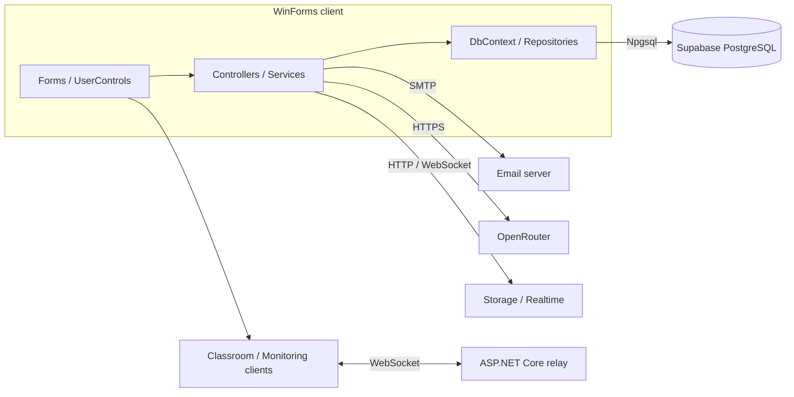
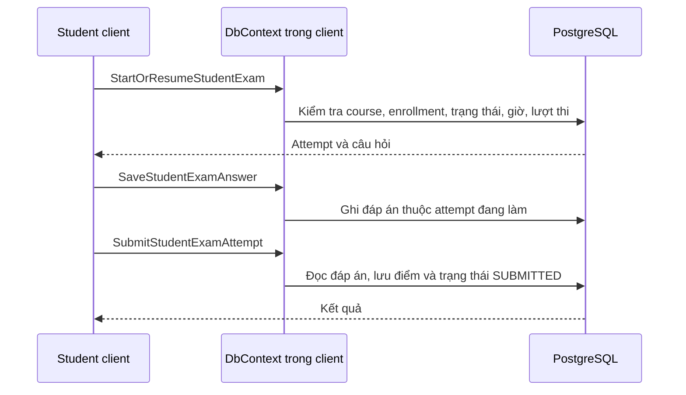

# CourseGuard — giới thiệu và kiến trúc bản dev

Tài liệu thuyết trình đồng bộ với baseline kiểm tra ngày 19/09/2026. Phân biệt ba mức: **có code**, **đã kiểm thử một phần**, **còn phải nghiệm thu**. Không mô tả tính năng dự kiến như khả năng đã được xác nhận.

## 1. Bài toán và mục tiêu

CourseGuard là đồ án C# Windows Forms phục vụ quản lý khóa học và tổ chức thi trực tuyến theo ba vai trò: admin, teacher, student. Mục tiêu là tập trung nội dung học, bài tập, đề thi, kết quả và công cụ giao tiếp trong một ứng dụng desktop.

Các vấn đề hướng tới: quy trình học/thi phân tán, theo dõi bài làm và kết quả, hỗ trợ giám sát, giảm nguy cơ mất đáp án khi đường truyền lỗi. Ứng dụng không bảo đảm ngăn mọi hành vi gian lận hoặc phục hồi mọi sự cố.

## 2. Công nghệ sử dụng

| Thành phần | Công nghệ trong source |
| --- | --- |
| Client | C#, .NET 10 Windows, WinForms |
| Truy cập database | Npgsql, PostgreSQL trên Supabase |
| Relay độc lập | ASP.NET Core, WebSocket |
| Email | MailKit/MimeKit SMTP; repository cũng có helper Gmail API |
| AI | HttpClient gọi OpenRouter; model lấy từ cấu hình |
| Camera/giao diện lớp học | AForge.Video, WebView2, mã WebRTC và native classroom |
| Báo cáo | ScottPlot.WinForms, MiniExcel, ClosedXML, CsvHelper |
| Dịch vụ khác | Supabase Storage, Supabase Realtime; cần cấu hình và quyền riêng |

Danh sách package không chứng minh mọi tính năng đã hoạt động trên môi trường deploy. Repo có relay server, nhưng chưa xác nhận một địa chỉ hosting cloud của nhóm đã chạy được cho mọi client.

## 3. Kiến trúc thực tế

Các tầng giao diện, nghiệp vụ và dữ liệu được tổ chức trong client. Database CRUD không bắt buộc đi qua relay HTTP.

- `CourseGuardDbContext` chứa SQL và quản lý kết nối/giao dịch qua Npgsql, không phải Entity Framework.
- `CourseGuardRelayApi` cung cấp `/relay`, `/classroom-relay`, `/classroom-status-relay` cho truyền tiếp thông tin thời gian thực.
- Database mới được khởi tạo từ schema và migrations, tách khỏi database cũ của nhóm nguồn.
- `.env` hoặc biến môi trường cung cấp DB, SMTP, Supabase, AI và cấu hình relay liên quan. Secret không nằm trong baseline Git mới.
- Phân tầng code trong desktop không tương đương kiến trúc ba server độc lập. Kết nối DB trực tiếp bằng credentials trong client là giới hạn cần xem xét trước production.

## 4. Phân hệ và vai trò

| Vai trò | Phạm vi giao diện/nghiệp vụ có trong repo | Còn cần nghiệm thu |
| --- | --- | --- |
| Admin | Tài khoản, duyệt yêu cầu, course, báo cáo, thiết bị, audit, settings | Luồng giao diện đầy đủ, phân quyền, trạng thái lỗi và email |
| Teacher | Course, bài học, tài liệu, bài tập, lịch, đề thi, kết quả, giám sát, lớp học | Workflow xuyên màn hình, hai máy, export, quyền theo course |
| Student | Đăng ký course, học liệu, bài tập, làm thi, kết quả, lịch, chat/lớp học | Upload, mất mạng, OTP, quyền dữ liệu và trạng thái rỗng/lỗi |

Không chỉ căn cứ vào nút hiển thị để kết luận phân quyền đạt; cần kiểm tra backend và quyền sở hữu đối tượng.

## 5. Xác thực và mật khẩu

Tài khoản ứng dụng nằm trong bảng `users`. Luồng đăng nhập chính dùng `AuthController`, kiểm tra password hash và trạng thái tài khoản; `LoginAsync` tạo OTP, lưu OTP rồi đưa email vào hàng đợi. Người dùng hoàn tất MFA trước khi vào giao diện theo vai trò.

- `PasswordHasher` hỗ trợ PBKDF2 và kiểm tra hash cũ để nâng cấp khi đăng nhập.
- `UserIdentityBloomIndex` hỗ trợ kiểm tra username nhanh; vẫn cần database để xác thực. Không khẳng định Bloom filter tự bảo đảm dữ liệu luôn mới.
- Có logic khóa tài khoản, mật khẩu tạm/hết hạn và bắt đổi mật khẩu.
- Có helper Supabase Auth trong repo, nhưng không mô tả nó là hệ thống xác thực duy nhất của ứng dụng.
- Smoke test đã xác minh mật khẩu seed qua `Login` đồng bộ. Đăng nhập UI qua OTP/email chưa được nghiệm thu; email seed `.local` không nhận thư thật.
- SMTP không có tài khoản mặc định. Thiếu cấu hình và kết quả gửi thất bại trong email queue còn cần xử lý.

## 6. Quản lý khóa học và học tập

Source có course workspace theo course được chọn, bài học, tài liệu, bài tập, lịch, điểm danh, thông báo, chat và công cụ xuất dữ liệu. Admin xử lý course/user theo vai trò; teacher quản lý nội dung; student xem/nộp theo quyền.

Cách lưu tài nguyên tùy chức năng; không khẳng định mọi tài liệu/bài nộp đều đi qua Supabase Storage. Storage, bucket/policy và Realtime của project mới cần kiểm thử riêng.

Lớp học có code native classroom, camera/share screen, WebView2/WebRTC và relay. Phải chạy hai máy, kiểm tra join/leave, reconnect và khác mạng trước khi khẳng định triển khai đa máy thành công.

## 7. Luồng thi và chấm điểm

Bản sửa thống nhất xử lý đáp án rỗng và làm tròn điểm decimal ở hai service. Database smoke test đã kiểm tra bài một câu đúng được 10/10, resume giữ đáp án, chặn sửa sau nộp và giới hạn lượt thi.

Đồng hồ trong `DoExamForm` dùng thời gian bắt đầu cộng thời lượng và so với `DateTime.Now`; không khẳng định đã chống chỉnh giờ local bằng đồng hồ server. Điều kiện mở bài đọc DB nhưng so sánh giờ cũng cần xem xét riêng. Không có bằng chứng trong lần kiểm tra này rằng luồng thi bắt buộc mật khẩu phòng thi.

## 8. Cache và công cụ giám sát

- `LocalAnswerCache` ghi ra file tạm, flush rồi thay thế file đích; khóa các thao tác trong một process để giảm mất đáp án khi ghi đồng thời.
- Giữ định dạng mã hóa cũ và cơ chế bắt lỗi best-effort. Test file không đồng nghĩa luồng UI tự lưu offline đã hoàn chỉnh; cần kiểm tra mất mạng khi chọn đáp án, nộp bài và khởi động lại.
- Code có keyboard hook, xử lý mất focus/đóng form, ghi vi phạm và truyền ảnh màn hình. Phần timer hiện có nhiệm vụ thử đồng bộ cache; không mô tả kiểm tra màn hình phụ/ứng dụng cấm là luôn bật.
- Chưa xác nhận giám sát webcam liên tục hoặc mọi hành vi điều khiển từ xa. Các tính năng này phải được đối chiếu với giao diện và test hai máy.
- Không gọi đây là giải pháp chống gian lận tuyệt đối. Cần chốt chính sách, tránh ghi vi phạm sai khi mở dialog hợp lệ và dọn tài nguyên khi thoát.

## 9. AI và xử lý lỗi dịch vụ

`AiQuestionGeneratorService` có sinh câu hỏi, tutor, flashcard và gợi ý chấm tự luận. `AiQuestionGeneratorDialog` là đường UI sinh câu hỏi; các service còn lại cần xác nhận đường truy cập UI theo phạm vi nhóm.

Bản cũ dùng danh sách model không còn có trong danh sách provider lúc kiểm tra và có thể trả điểm mẫu khi gọi lỗi. Bản sửa đọc key từ môi trường, cho cấu hình model, mặc định `openrouter/free`, giới hạn HTTP timeout 45 giây và báo lỗi HTTP/nội dung sai thay vì tạo điểm mẫu.

Bốn yêu cầu AI thật đã đạt ở lần kiểm thử đã ghi nhận. Điều đó không bảo đảm model/quota/mạng luôn sẵn sàng và không chứng minh chất lượng sư phạm của mọi kết quả. Giáo viên cần xem lại nội dung/điểm gợi ý.

## 10. Kết quả kiểm thử đã ghi nhận

| Nhóm | Kết quả baseline | Không bao gồm |
| --- | --- | --- |
| Build solution | 0 lỗi, 0 cảnh báo hiển thị | Một số warning được cấu hình ẩn/hạ mức |
| Feature offline | 249 đạt, 3 ca tích hợp bỏ qua | Toàn bộ thao tác người dùng hoặc dịch vụ thật |
| Exam regression | 6/6 đạt | Mọi tình huống mất mạng đầu-cuối |
| Cloud DB integration | 3/3 đạt | Tất cả truy vấn và quyền truy cập của ứng dụng |
| AI integration | 4/4 đạt | Tất cả UI AI và mọi chất lượng câu trả lời |
| Dev exam smoke | Xác thực đồng bộ, mở/lưu/resume/nộp, điểm persisted, chặn sửa và hết lượt đạt | OTP/email và thao tác trực tiếp trên WinForms |

Schema + 16 migration đã áp dụng trên Supabase dev mới; fixture bài thi được dọn sau test. Không chạy schema reset để minh họa trên database đang dùng.

## 11. Kịch bản trình bày/demo

1. Giới thiệu ba vai trò và sơ đồ kết nối thực tế.
2. Trình bày cấu hình bằng `.env.example`, không mở file chứa secret trước khán giả.
3. Cho thấy kết quả build và các bộ test; phân biệt test offline với cloud smoke test.
4. Trình bày luồng thi qua smoke test và điểm được lưu; chỉ demo UI đăng nhập khi SMTP/OTP đã được nhóm nghiệm thu.
5. Demo sinh câu hỏi AI khi dịch vụ khả dụng; nếu lỗi, trình bày lỗi thật.
6. Demo chat/lớp học/giám sát hai máy sau khi nhánh realtime và exam đã cung cấp bằng chứng.
7. Kết thúc bằng giới hạn và kế hoạch hoàn thiện, không tuyên bố các phần chưa kiểm thử đã hoàn thành.

## 12. Phân công và bước tiếp theo

- Người 1: tài khoản, OTP/email, admin và phân quyền.
- Người 2: workflow course/học tập/bài tập, lịch/kết quả, AI trên UI.
- Người 3: soạn/làm thi, mất mạng/cache, chấm điểm và giám sát.
- Người 4: chat, storage, lớp học trực tuyến và relay.
- Trưởng nhóm: cấu hình chung, migration, review/merge, CI Windows và nghiệm thu máy clone mới.

Chi tiết và tiêu chí hoàn thành: [TEAM_HANDOFF](docs/TEAM_HANDOFF.md). Cách chạy và lệnh test: [README](docs/README.md). Bản thuyết trình này dùng sơ đồ Mermaid có trong tài liệu thay cho các liên kết ảnh `file:///` trỏ máy cũ.
