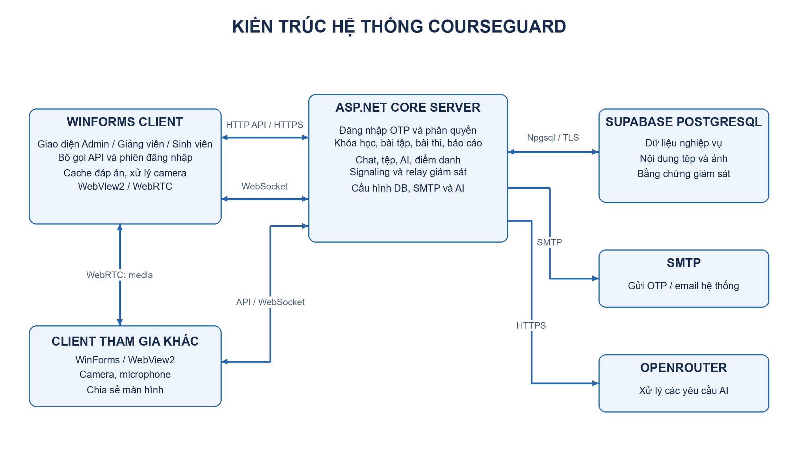

# CourseGuard — giới thiệu bản client–server

CourseGuard là đồ án C#/.NET 10 Windows Forms quản lý khóa học, bài tập, thi và lớp học trực tuyến cho Admin, giảng viên và sinh viên.

## Kiến trúc đang dùng

WinForms gọi ASP.NET Core Server; server xử lý xác thực, phân quyền, nghiệp vụ và truy vấn PostgreSQL trên Supabase. Database, SMTP và khóa AI nằm trên server. Client chỉ cấu hình địa chỉ API.

Server tái sử dụng lớp nghiệp vụ và SQL của dự án để giữ chức năng hiện có. Chat lấy tin định kỳ qua API. Signaling WebRTC và frame giám sát đi qua WebSocket có xác thực; camera/mic/chia sẻ màn hình dùng WebRTC giữa các bên tham gia. STUN/TURN là phần cấu hình triển khai media khi khác mạng.

## Vai trò

- Admin: quản lý và phê duyệt tài khoản/khóa học, bảng điểm, thiết bị, báo cáo và cấu hình server.
- Giảng viên: khóa học, bài giảng/tài liệu, bài tập, đề thi/câu hỏi, kết quả, lịch học, điểm danh và giám sát.
- Sinh viên: đăng ký học, đọc nội dung, nộp bài tập, làm/nộp bài thi, xem kết quả và tham gia lớp học/chat.

## Đã kiểm tra

Build client/server sạch; 249 ca offline đạt, 3 ca tích hợp bỏ qua. Đăng nhập OTP ba vai trò và các luồng API chính đã chạy với database/SMTP thật. Luồng thử gồm phê duyệt khóa học/ghi danh, chat/tệp/poll, nộp bài tập, làm/nộp bài thi và chấm điểm. Ba dashboard WinForms mở và tải dữ liệu bằng cấu hình client không có mật khẩu database/SMTP.

Signaling có kiểm tra danh tính và chống dùng lại vé; frame giám sát đã kiểm tra bằng dữ liệu giả lập. Các kiểm tra này chưa xác nhận chất lượng camera/mic trên hai máy khác mạng, mọi thao tác giao diện hoặc mọi tình huống nghiệp vụ. Các cải tiến tính năng của thành viên tiếp tục được nghiệm thu ở PR riêng.

Chi tiết: [hướng dẫn chạy](docs/README.md), [kiến trúc](docs/architecture.md), [kết quả kiểm thử và giới hạn](docs/SERVER_MIGRATION.md).
